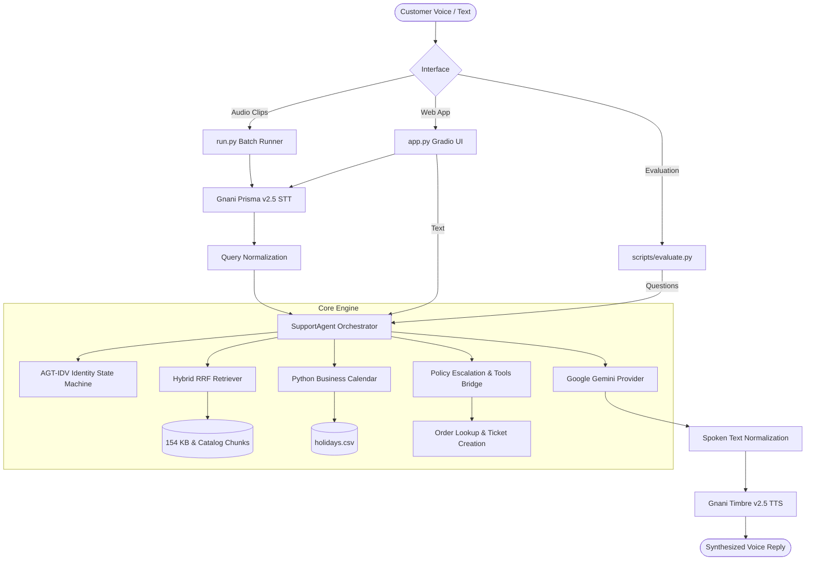

# VoiceOps 2026: ZentroMart AI Customer Support Agent

[](#)
[](#)
[](#)
[](#)
[](#)

**Public GitHub Repository**: [https://github.com/saivardhankundala2005-sys/zentromart-voiceops.git](https://github.com/saivardhankundala2005-sys/zentromart-voiceops.git)

Production-grade, omnichannel conversational AI customer support platform built for **ZentroMart** (fictional Indian groceries and electronics retailer). Powered by a unified Python agent engine supporting:
1. **Interactive Gradio SaaS Web Application** (`app.py`)
2. **Batch Audio CLI Runner** (`run.py` & `run.sh`)
3. **Automated Evaluation Harness** (`scripts/evaluate.py`)

---

## 📌 Key Architectural Capabilities

- **Strict Document Grounding & Policy Precedence**: Merges 3072-dimensional Gemini embeddings (`gemini-embedding-001`) with sparse BM25 keyword matching via Reciprocal Rank Fusion (RRF). Prioritizes authoritative policies (`REF-2`) over outdated FAQs (`FAQ-1`) with a **0.0% hard-negative hit rate**.
- **Deterministic Business Calendar**: Mon–Sat working days skipping Sundays and gazetted warehouse holidays (Independence Day, Gandhi Jayanti, 19 October 2026, 09 November 2026). Computes return deadlines and refund SLAs relative to the fixed **`2026-10-20`** reference date.
- **AGT-IDV Caller Identity Verification**: State machine that challenges customers for proof (last 4 digits of phone or 6-digit delivery pincode) before disclosing order facts, enforcing a strict 1-retry limit before lockout.
- **Policy Escalation Engine**: Deterministically identifies claims exceeding ₹10,000, repeat contacts ($\ge 2$), and overdue refunds, creates audit tickets (`create_ticket`), and refuses unauthorized compensation.
- **Gnani.ai Voice Integration**: Speech recognition via `gnani-prisma-v2.5` and high-fidelity speech synthesis via `timbre-v2.5` (voice `Kaveri`).

---

## 🏗️ System Architecture



---

## 🚀 Quickstart & Setup

### 1. Prerequisites
- Python 3.10+ (tested on Python 3.14)
- Google Gemini API Key
- Gnani.ai API Key

### 2. Environment Configuration
Copy `.env.example` to `.env` and fill in your active API credentials:
```bash
cp .env.example .env
```

Edit `.env`:
```ini
GNANI_API_KEY=your_gnani_api_key_here
GEMINI_API_KEY=your_gemini_api_key_here
LLM_MODEL=gemini-3.5-flash-lite
EMBEDDING_MODEL=gemini-embedding-001
REFERENCE_DATE=2026-10-20
STT_LANG=en-IN
TTS_MODEL=timbre-v2.5
TTS_VOICE=Kaveri
```

### 3. Installation
Install dependencies and install the package in editable mode:
```bash
pip install -r requirements.txt
pip install -e .
```

### 4. Build Knowledge Base Index
Generate embeddings for the 21 knowledge base documents and 70 product catalog SKUs:
```bash
python scripts/build_index.py
```
*Index is saved to `data_index/kb_index_cache.json` for instant sub-second retrieval.*

---

## 💻 Running the Interfaces

### 1. Gradio SaaS Web Application
Launch the interactive 6-tab customer support portal:
```bash
python app.py
```
Open [http://localhost:7860](http://localhost:7860) in your web browser.
- **Tab 1: Customer Support**: Interactive text chat with real-time decision and tool inspector.
- **Tab 2: Voice Assistant**: Record or upload voice clips with latency breakdown.
- **Tab 3: Knowledge Base Browser**: Live search across 154 indexed chunks.
- **Tab 4: Order Verification Demo**: Walkthrough of the AGT-IDV caller identity gate.
- **Tab 5: Evaluation Lab**: Real-time benchmark comparison table.
- **Tab 6: System Diagnostics & 1-Click Demo Scenarios**: Instant scenario launchers.

### 2. Batch Audio CLI Runner
Process a folder of customer audio clips (.wav, .mp3, etc.):
```bash
python run.py --input-dir /path/to/customer_audio --output-dir /path/to/output_folder
```
Or using the Unix bash wrapper:
```bash
./run.sh --input-dir /path/to/customer_audio --output-dir /path/to/output_folder
```

**Per-clip outputs generated**:
- `<clip_name>.json`: Full turn transcript, reply, decision, retrieved chunk IDs, tool calls, and latencies.
- `<clip_name>_reply.wav`: High-quality synthesized spoken reply from Gnani Timbre v2.5.
- `results.csv`: Consolidated batch tabular log.
- `batch_summary.json`: Aggregate statistics and performance summary.

---

## 📊 Evaluation & Benchmarks

Run the complete evaluation suite across Baseline, Grounded RAG, ASR Robustness, and Multi-turn Conversations:
```bash
python scripts/evaluate.py --step all --limit 5
```

### Benchmark Results Comparison

| Evaluation Phase | Total Samples | Must-Include Acc | Must-Not-Include Acc | Decision Acc | Overall Pass Rate | Avg Latency |
|:---|:---:|:---:|:---:|:---:|:---:|:---:|
| **Step 1: Baseline** | 5 | 20.0% | 100.0% | 100.0% | **20.0%** | 919.4 ms |
| **Step 2: Grounded RAG** | 5 | 80.0% | 100.0% | 100.0% | **80.0%** | 2,098.3 ms |
| **Step 2: RAG (ASR Robustness)** | 5 | 80.0% | 100.0% | 100.0% | **80.0%** | 3,470.2 ms |
| **Step 3: Multi-turn Convs** | 22 turns | 100.0% | 100.0% | 95.45% | **95.45%** | 3,162.6 ms |

---

## 🧪 Testing & Verification

Run the automated test suite:
```bash
pytest tests/ -v
```

Run pre-submission compliance verification (checks for secrets, isolation, CLI, and tests):
```bash
python scripts/presubmit_check.py
```

Create a clean submission archive:
```bash
python scripts/package_submission.py voiceops_submission.zip
```

---

## 📁 Repository Structure

```
├── app.py                      # Interactive Gradio SaaS web application
├── run.py                      # Batch audio CLI runner
├── run.sh                      # Shell wrapper for batch runner
├── pyproject.toml              # Editable package configuration
├── requirements.txt            # Pinned production dependencies
├── .env.example                # Blank configuration template
├── README.md                   # System documentation
├── report.md                   # 4-page capstone technical report
├── demo_script.md              # 2-minute video presentation script
├── src/voiceops/               # Core Python package
│   ├── agent/                  # Orchestrator, IDV state machine, policy engine
│   ├── data/                   # Data loader, business calendar, order facts
│   ├── evaluation/             # Must-include, must-not-include, decision metrics
│   ├── knowledge/              # Markdown section chunker, hybrid RRF indexer
│   ├── llm/                    # Resilient Gemini provider with model fallback
│   └── voice/                  # Gnani STT & TTS clients, audio utils, normalization
├── scripts/                    # CLI utilities
│   ├── build_index.py          # Builds and caches KB index
│   ├── verify_retrieval.py     # Verifies retrieval recall & hard negatives
│   ├── evaluate.py             # Benchmark evaluation harness
│   ├── presubmit_check.py      # Pre-submission verification script
│   └── package_submission.py   # Clean submission packager
├── tests/                      # Comprehensive pytest test suite
│   ├── test_data_and_calendar.py
│   ├── test_tools_and_verification.py
│   ├── test_agent_conversation.py
│   ├── test_voice_layer.py
│   ├── test_cli_runner.py
│   └── test_evaluation_metrics.py
├── reports/                    # Benchmark CSVs, summary JSON, and comparison MD
└── sample_outputs/             # Genuine batch runner JSON and WAV outputs
```
